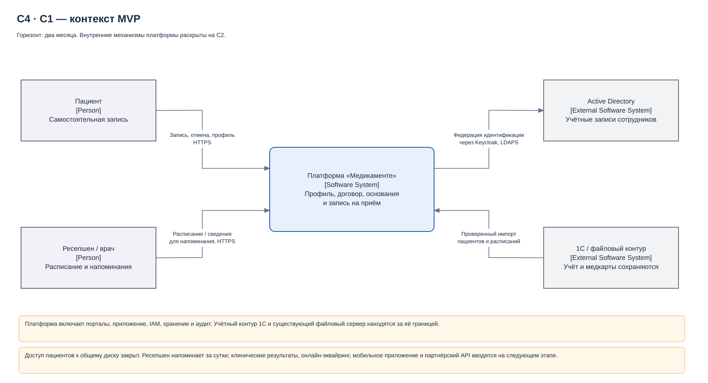
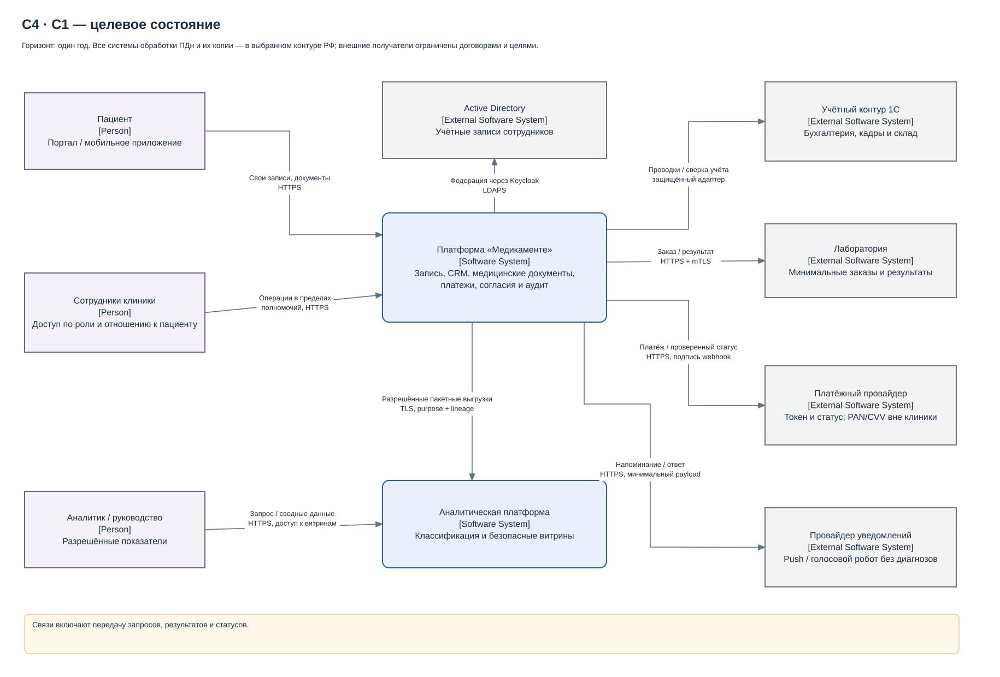
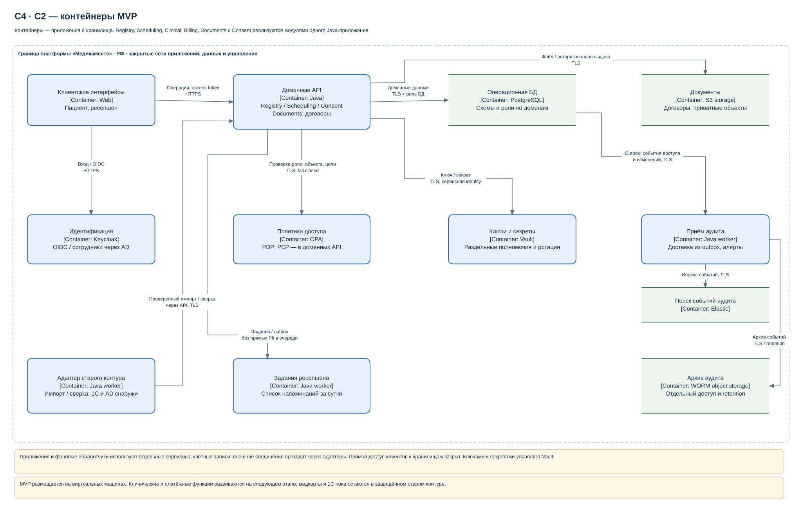
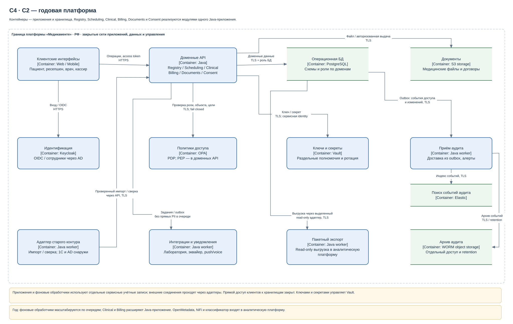

# Task2. Архитектура с Privacy by Design

Решение автоматизирует запись пациентов и ограничивает распространение медицинских и персональных данных. Архитектура описана для двух горизонтов: **MVP через два месяца** и **целевое состояние через год**.

**Стадия: архитектурное проектирование.**

[Краткий разбор четырёх схем](overview.md) — что показано, зачем приняты решения и что проверить. [Подробное описание архитектуры](architecture.md) — обоснование, правила защиты и критерии приёмки.

## Диаграммы

- **C1, MVP:** [Контекстная схема MVP (SVG)](diagrams/context-mvp.svg) · [Контекстная схема MVP (draw.io)](diagrams/context-mvp.drawio). Самостоятельная запись через портал, работа ресепшена и напоминания за сутки до приёма.
- **C1, через год:** [Целевая контекстная схема (SVG)](diagrams/context-target.svg) · [Целевая контекстная схема (draw.io)](diagrams/context-target.drawio). Мобильное приложение, уведомления, платежи и лабораторная интеграция.
- **C2, MVP:** [Контейнерная схема MVP (SVG)](diagrams/containers-mvp.svg).
- **C2, через год:** [Целевая контейнерная схема (SVG)](diagrams/containers-target.svg).
- **C2, оба этапа:** [Контейнерные схемы MVP и целевого состояния (draw.io)](diagrams/containers.drawio), страницы `MVP` и `Target`.

C1 показывает людей, платформу и внешние системы. C2 раскрывает приложения и хранилища, включая средства защиты и связь с аналитическим контуром. Бизнес-домены реализуются модулями одного Java-приложения.

## Обоснование и проверка

[architecture.md](architecture.md) описывает границы доменов и источники истины, RBAC/ABAC, семь принципов PbD, аналитику, теги, CI, аудит, этапы и критерии приёмки. Решение продолжает [риски R01–R12](../Task1/problems.md) и [модель защиты и тегирования Task1](../Task1/data-protection.md).

Порядок проверки архитектуры:

1. Открыть оба C1 и сверить изменение пользовательских сценариев между двумя месяцами и годом.
2. Открыть две страницы C2: проследить путь запроса через авторизацию, приложение и разрешённое хранилище; отделить внешние системы от контейнеров платформы.
3. Сверить права, классификацию и источники истины с `architecture.md`: в MVP учёт сохраняется в 1С, аналитический контур вводится на этапе развития.
4. Сопоставить компоненты и механизмы защиты со сценариями приёмки в конце `architecture.md`. Для каждого сценария должны быть определены проверка и ожидаемый результат.
