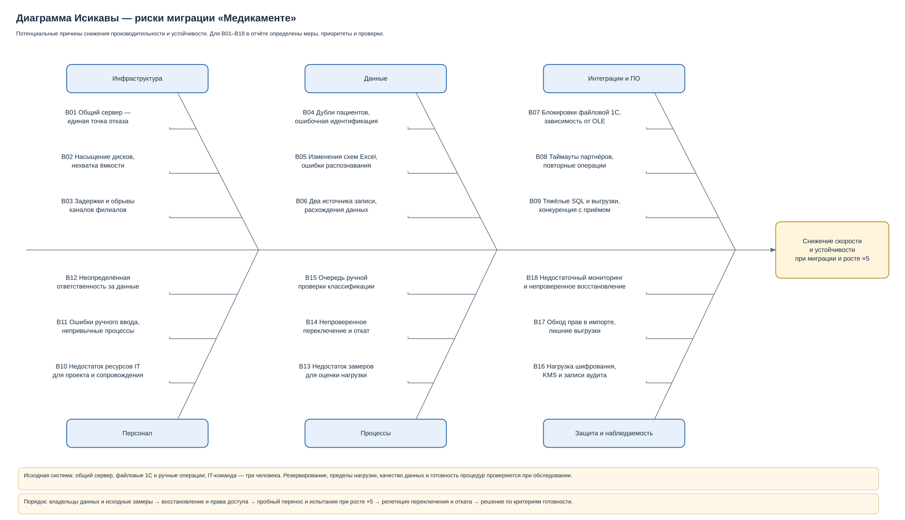

# Task4. Узкие места при миграции

Диаграмма Исикавы показывает причины задержек, рассинхронизации и потери данных при миграции и пятикратном росте нагрузки. Для 18 причин определены меры, приоритеты и способы проверки.

**Стадия: архитектурное проектирование.**

## Краткое решение

- **Инфраструктура:** разделить службы общего сервера, проверить восстановление, рассчитать запас дисков и пропускную способность каналов филиалов.
- **Данные:** сопоставить пациентов и исходные записи, проверить форматы и распознавание сканов, разрешить изменение каждого объекта только в одной системе.
- **Интеграции и ПО:** ограничить нагрузку на файловые 1С, защититься от повторных платежей и запросов, отделить тяжёлые выгрузки от записи пациентов.
- **Персонал:** назначить владельцев данных и исполнителей миграции, обеспечить разработку и сопровождение, обучить сотрудников новым процессам.
- **Процессы:** измерить исходную нагрузку, проверить рост в пять раз, провести репетицию переключения и отката, контролировать очередь ручной проверки данных.
- **Защита и наблюдаемость:** ограничить права миграции, измерить задержки шифрования и проверок доступа, настроить оповещения и проверить восстановление с ключами.

**Приоритеты:** P0 — до переключения; P1 — до полной рабочей нагрузки и тиражирования; P2 — оптимизация по измерениям. Сначала устраняются риски ошибочного переноса, потери данных и невозможности восстановления.

## Материалы

- [Диаграмма Исикавы](diagrams/ishikawa.drawio).
- [Узкие места: причины, меры, приоритеты и проверки](bottlenecks.md).
- [Целевая архитектура и требования к производительности — Task2](../Task2/architecture.md), [исходные риски — Task1](../Task1/problems.md).

## Как проверить

1. Сопоставить шесть ветвей диаграммы и причины B01–B18 со строками отчёта.
2. Для каждой причины проследить связь: влияние на работу системы → мера → приоритет → проверка и метрика.
3. Проверить порядок работ: сопоставление данных, права и восстановление обеспечиваются до переключения; рост нагрузки проверяется вместе с переносом и резервированием.
4. Сверить [критерии готовности](bottlenecks.md#проверка-готовности) с Task2: время ответа, ошибки, сохранность подтверждённых операций и восстановление.
