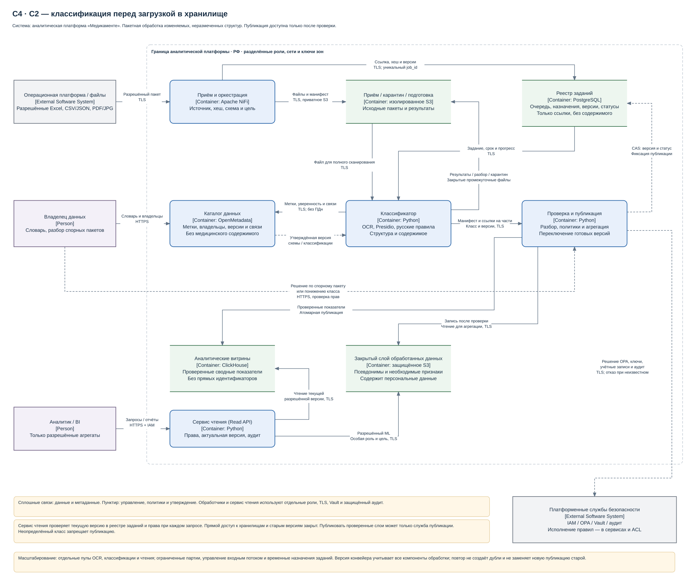

# Task6. Движок классификации данных

Движок определяет структуру и чувствительность данных перед пакетной загрузкой в аналитическое хранилище. Диаграмма контейнеров движка классификации показывает приём файлов, классификацию, проверку, публикацию и доступ к результатам.

**Стадия: архитектурное проектирование.**

## Краткое решение

- **Приём:** NiFi помещает файлы в закрытую зону S3 и регистрирует задание. Исходные данные недоступны аналитикам.
- **Классификация:** Python-обработчики проверяют все поля и страницы, распознают сканы и обнаруживают изменения структуры и содержимого. Метки и происхождение данных сохраняются в каталоге.
- **Ошибки и сомнения:** неполные или неизвестные данные остаются в карантине; спорная классификация направляется владельцу на разбор. Публикация ожидает решения и повторной проверки.
- **Публикация и доступ:** отдельная служба открывает только полностью проверенную версию. Персональные данные остаются в закрытом слое; аналитик получает сводные показатели через сервис чтения.
- **Качество:** критерии приёмки — полнота обнаружения медицинских сведений и прямых идентификаторов ≥99,5%, точность ≥95%, покрытие метками и прослеживаемость публикаций — 100%.
- **Рост и сбои:** обработчики масштабируются независимо, OCR выделен в отдельный пул. Очередь и контрольные точки позволяют продолжить работу после сбоя; при перегрузке приём замедляется без пропуска классификации.

## Материалы

- [Диаграмма контейнеров движка классификации](diagrams/classification-c2.drawio).
- [Архитектура, алгоритм, метрики и масштабирование](classification-engine.md).
- [Классификация данных — Task1](../Task1/data-protection.md), [целевая архитектура — Task2](../Task2/architecture.md), [защита данных — Task3](../Task3/protection-strategy.md).

## Как проверить

1. Проследить на схеме путь от исходного файла до аналитической витрины: классификация и проверка обязательны перед публикацией.
2. Сопоставить права компонентов с описанием: классификатор не публикует данные, аналитик читает только разрешённые витрины через сервис чтения.
3. Сверить [метрики качества](classification-engine.md#метрики-и-оптимизация) и [расчёт масштабирования](classification-engine.md#масштабирование-и-эксплуатация) с требованиями к изменению структуры и росту данных.
4. Проверить [сценарии приёмки](classification-engine.md#критерии-приёмки): новое поле, плохой скан, спорная метка, повтор задания, сбой публикации и попытка чтения старой версии.
